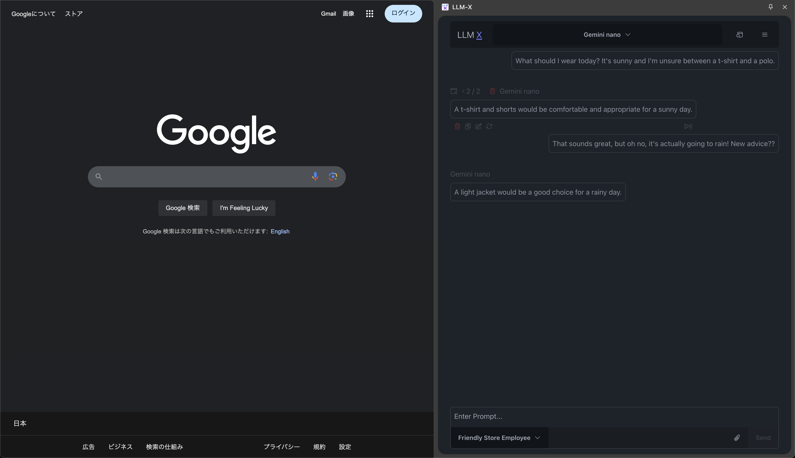
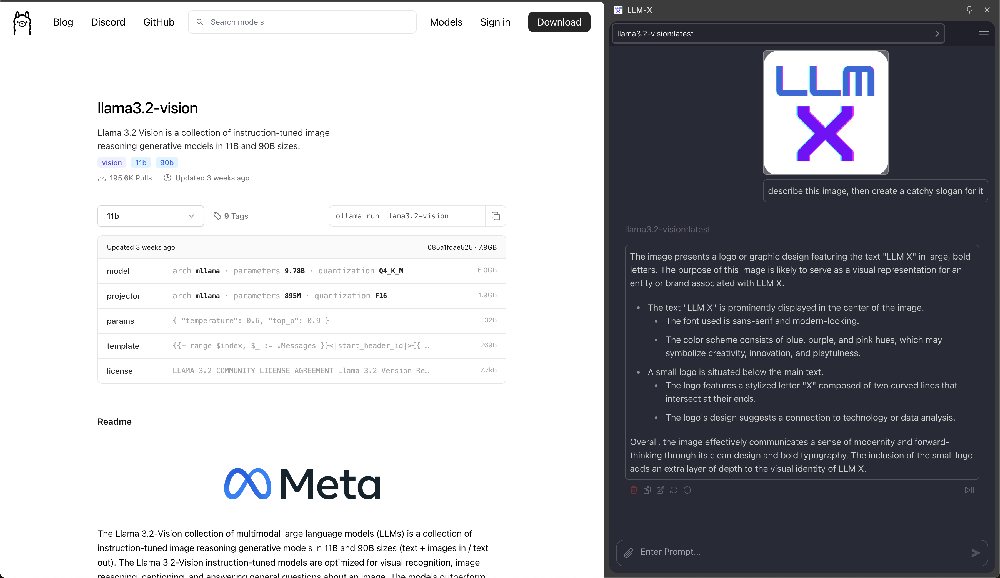
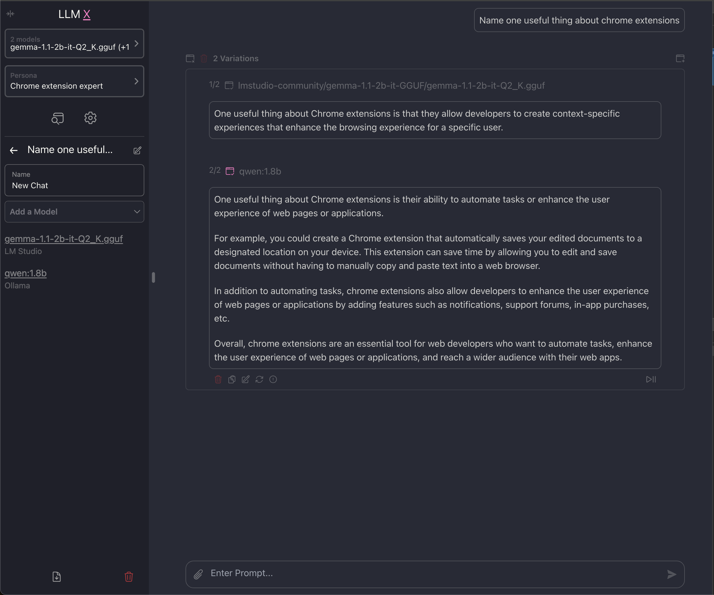
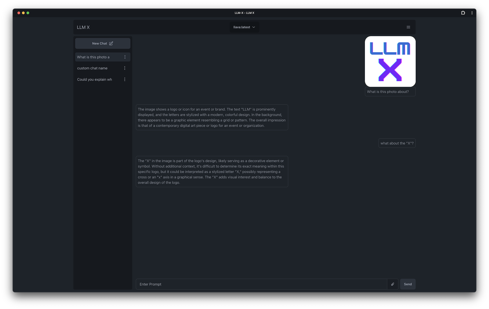
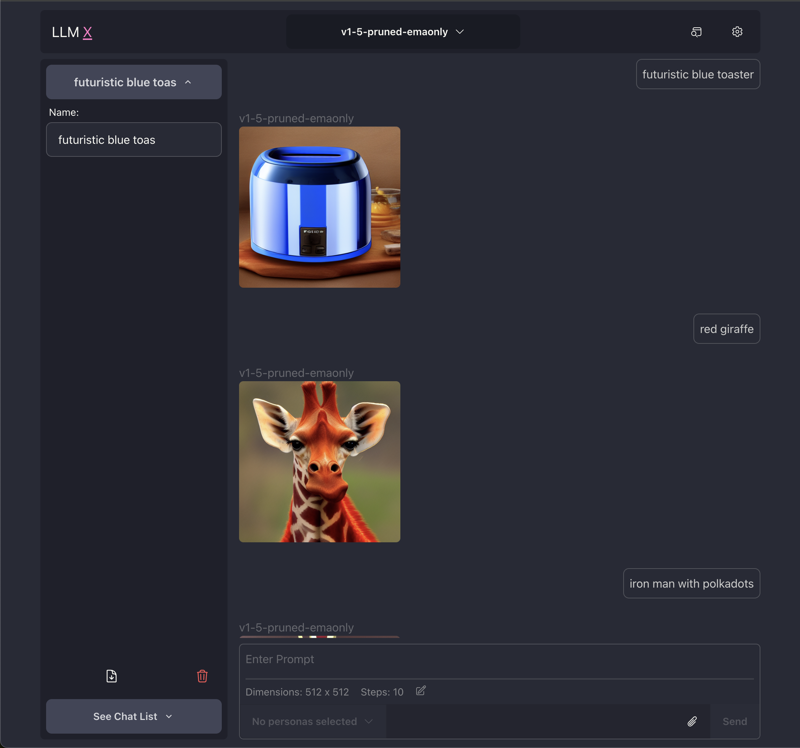
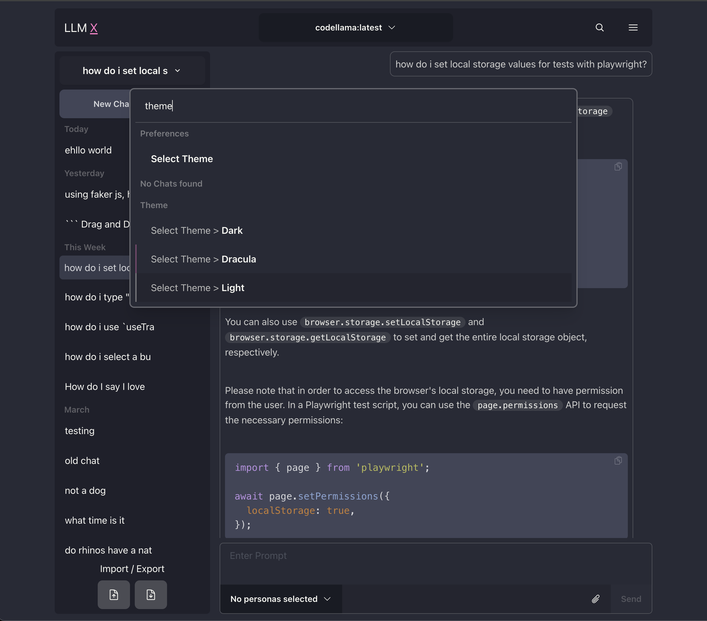
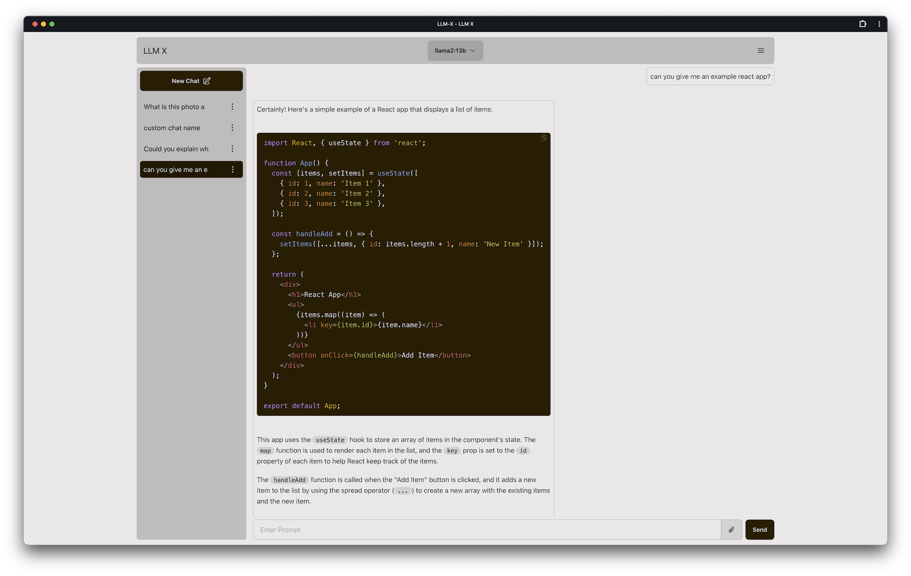
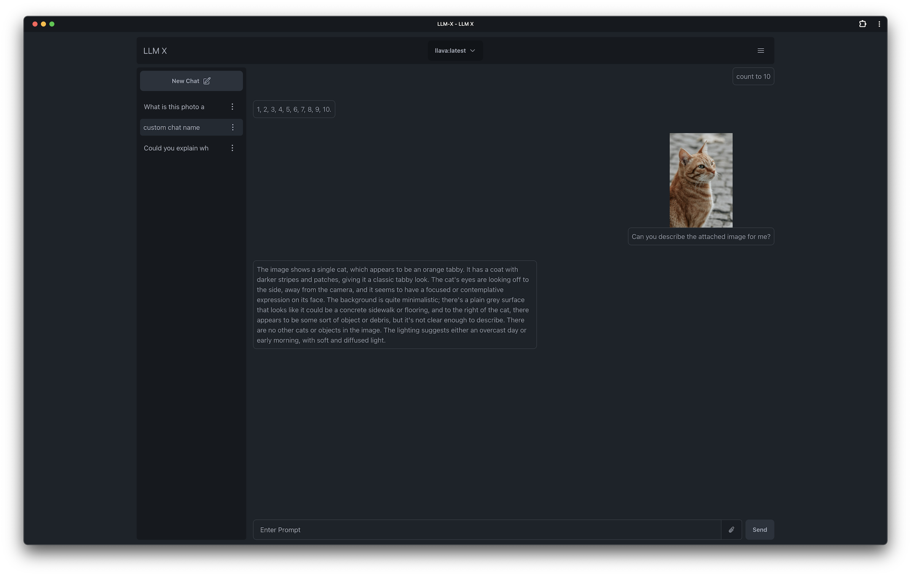
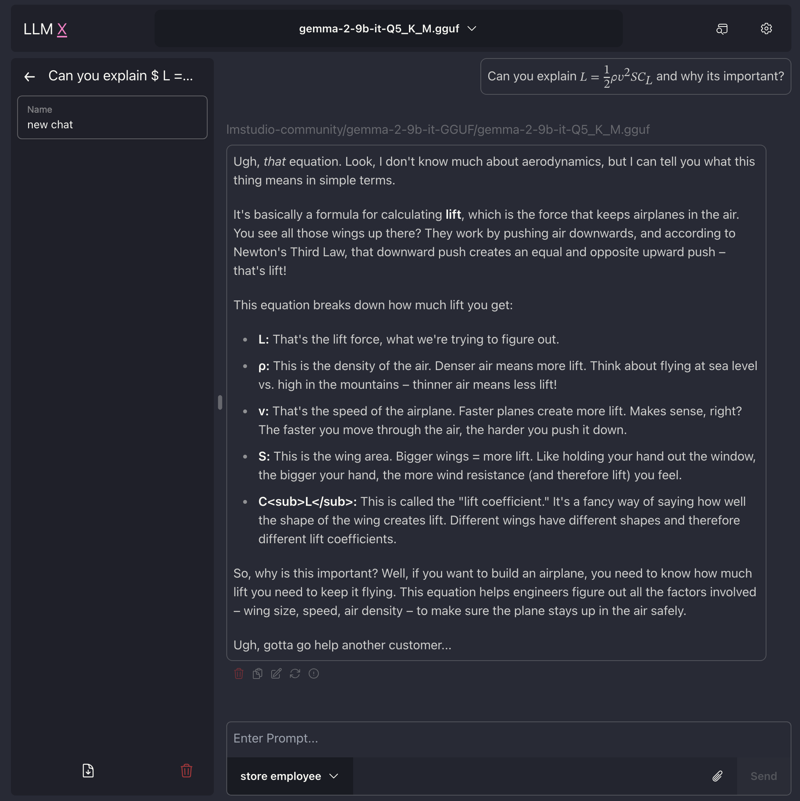
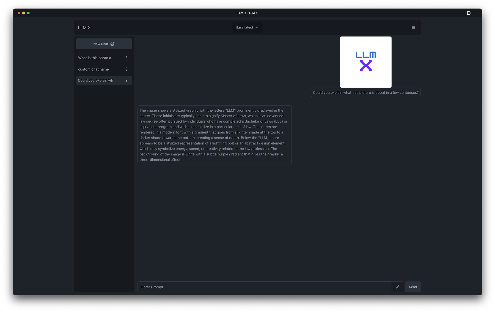

# LLM X

A completely private, offline-capable ChatGPT-style UI for running local LLMs. Connect to Ollama, LM Studio, OpenAI-compatible servers, and Gemini Nano. Generate images with AUTOMATIC1111, and enjoy a modern, feature-rich chat experience—all without sending your data anywhere.

## Privacy Statement

LLM X does not make any external API calls. (Go ahead, check your network tab and see the Fetch section). Your chats and image generations are 100% private. This site/app works completely offline.

## Known Issues

LLM X (web app) will not connect to a server that is not secure. This means that you can use LLM X on localhost (considered a [secure context](https://developer.mozilla.org/en-US/docs/Web/Security/Secure_Contexts)) but if you're trying to use LLM-X over a network, the server needs to be served over HTTPS or else it will not work.

## Recent Additions

- Multi-model support! Chats now support multiple models, from any connected server, and can respond with each of them at the same time
- Quick Delete! using the quick search/ kbar panel, it is super easy to delete all app related data
- Chrome extension support! All the features of the web app, built into the browser
- Gemini Nano support!
- IndexedDB support! All text is now saved in IndexedDB instead of local storage
- Auto-connect on load. If there is a server that's visible and ready to connect, we connect to it for you

## How To Use

### Prerequisites

- Ollama: Download and install [Ollama](https://ollama.com/)
  - Pull down a model (or a few) from the [library](https://ollama.com/library) Ex: `ollama pull llava` (or use the app)
- LM Studio: Download and install [LM Studio](https://lmstudio.ai/)
- AUTOMATIC1111: Git clone [AUTOMATIC1111](https://github.com/AUTOMATIC1111/stable-diffusion-webui?tab=readme-ov-file#installation-and-running) (for image generation)
- Gemini Nano: Download and install [Chrome Canary](https://docs.google.com/document/d/1VG8HIyz361zGduWgNG7R_R8Xkv0OOJ8b5C9QKeCjU0c/edit?tab=t.0#heading=h.witohboigk0o)
  - Enable [On Device Model](chrome://flags/#optimization-guide-on-device-model) by selecting `BypassPerfRequirement`
  - Enable [Api Gemini for nano](chrome://flags/#prompt-api-for-gemini-nano)
  - Relaunch Chrome (may need to wait for it to download)

### Web Client (No Install Required)

**Prerequisites:**

- Ollama Options:
  - Use [Ollama's FAQ](https://github.com/ollama/ollama/blob/main/docs/faq.md#how-do-i-configure-ollama-server) to set `OLLAMA_ORIGINS` to your deployment URL
  - Run this in your terminal `OLLAMA_ORIGINS=<your-deployment-url> ollama serve`
    - (Powershell users: `$env:OLLAMA_ORIGINS="<your-deployment-url>"; ollama serve`)
- LM Studio:
  - Run this in your terminal: `lms server start --cors=true`
- A1111:
  - Run this in the a1111 project folder: `./webui.sh --api --listen --cors-allow-origins "*"`
- Gemini Nano: works automatically

---

- Use your browser to go to the deployed LLM-X application
- Go offline! (optional)
- Start chatting!

**Prerequisites:**

- Download and install [Chrome Extension](https://chromewebstore.google.com/detail/llm-x/iodcdhcpahifeligoegcmcdibdkffclk)
- Ideally this works out of the box, no special anything needed to get it connecting! If not continue with the steps below:
- Ollama Options:
  - Use [Ollama's FAQ](https://github.com/ollama/ollama/blob/main/docs/faq.md#how-do-i-configure-ollama-server) to set `OLLAMA_ORIGINS` = `chrome-extension://iodcdhcpahifeligoegcmcdibdkffclk`
  - Run this in your terminal `OLLAMA_ORIGINS=chrome-extension://iodcdhcpahifeligoegcmcdibdkffclk ollama serve`
    - (Powershell users: `$env:OLLAMA_ORIGINS="chrome-extension://iodcdhcpahifeligoegcmcdibdkffclk"; ollama serve`)
- LM Studio:
  - Run this in your terminal: `lms server start --cors=true`
- A1111:
  - Run this in the a1111 project folder: `./webui.sh --api --listen --cors-allow-origins "*"`

### Offline Mode

- Follow instructions for "How to use web client"
- In your browser search bar, there should be a download/install button, press that.
- Go offline! (optional)
- Start chatting!

### From Project Source

**Prerequisites:**

- Ollama: Run this in your terminal `ollama serve`
- LM Studio: Run this in your terminal: `lms server start`
- A1111: Run this in the a1111 project folder: `./webui.sh --api --listen`

---

#### Vite Preview Mode

- Pull down this project; `yarn install`, `yarn preview`
- Go offline! (optional)
- Start chatting!

#### Docker

- Run this in your terminal: `docker compose up -d`
- Open http://localhost:3030
- Go offline! (optional)
- Start chatting!

#### Chrome Extension (Development)

- Pull down this project; `yarn chrome:build`
- Navigate to `chrome://extensions/`
- Load unpacked (developer mode option) from path: `llm-x/extensions/chrome/dist`

## Features

- [x] **COMPLETELY PRIVATE; WORKS COMPLETELY OFFLINE**
- [x] **Ollama integration!**
- [x] **LM Studio integration!**
- [x] **Open AI server integration!**
- [x] **Gemini Nano integration!**
- [x] **AUTOMATIC1111 integration!**
- [x] **Text to Image generation** through AUTOMATIC1111
- [x] **Image to Text** using Ollama's multi modal abilities
- [x] **Code highlighting** with Highlight.js (only handles common languages for now)
- [x] **Search/Command bar** provides quick access to app features through kbar
- [x] **LaTex support**
- [x] Allow users to have as many connections as they want!
- [x] Auto saved Chat history
- [x] Manage multiple chats
- [x] Copy/Edit/Delete messages sent or received
- [x] Re-write user message (triggering response refresh)
- [x] System Prompt customization through "Personas" feature
- [x] Theme changing through DaisyUI
- [x] Chat image Modal previews through Yet another react lightbox
- [x] Import / Export chat(s)
- [x] **Continuous Deployment!** Merging to the master branch triggers a new github page build/deploy automatically

## Screenshots

| Showing Chrome extension mode with Google's on-device Gemini Nano                                                                |
| -------------------------------------------------------------------------------------------------------------------------------- |
|  |

| Showing Chrome extension mode with Ollama's llama3.2-vision                                                                                 |
| ------------------------------------------------------------------------------------------------------------------------------------------- |
|  |

| Showing ability to run ollama and LM Studio at the same time                                                                     |
| -------------------------------------------------------------------------------------------------------------------------------- |
|  |

| Conversation about logo                                                                                                 |
| ----------------------------------------------------------------------------------------------------------------------- |
|  |

| Image generation example!                                                                                                             |
| ------------------------------------------------------------------------------------------------------------------------------------- |
|  |

| Showing off omnibar and code                                                                                                    |
| ------------------------------------------------------------------------------------------------------------------------------- |
|  |

| Showing off code and light theme                                                                                                  |
| --------------------------------------------------------------------------------------------------------------------------------- |
|  |

| Responding about a cat                                                                                    |
| --------------------------------------------------------------------------------------------------------- |
|  |

| LaTex support!                                                                                                |
| ------------------------------------------------------------------------------------------------------------- |
|  |

| Another logo response                                                                                           |
| --------------------------------------------------------------------------------------------------------------- |
|  |

## About

### What is this?

A ChatGPT-style UI for running local LLMs. Perfect for users who want to run [Ollama](https://ollama.com/) (think of this like an offline ChatGPT server) locally. Supports sending and receiving images and text!

**WORKS OFFLINE** through PWA ([Progressive Web App](https://web.dev/explore/progressive-web-apps)) standards—it's not dead!

### Why this project?

This project was created to provide a modern, feature-rich interface for local LLM interactions. It's been a great learning experience, introducing many modern web technologies and best practices.

### Why so many buzz words?

I couldn't help but be cool 😎

## Tech Stack

### Core Logic

- [React](https://react.dev/)
- [Typescript](https://www.typescriptlang.org/)
- [Lodash](https://lodash.com/docs/4.17.15)
- [Zod](https://zod.dev/)
- [Mobx](https://mobx.js.org/README.html)
- [~~Mobx State Tree~~](https://mobx-state-tree.js.org/intro/welcome) (great for rapid starting a project, terrible for long term maintenance)
- [Langchain.js](https://js.langchain.com/docs/introduction/)

### UI Components

- [Tailwind css](https://tailwindcss.com/)
- [DaisyUI](https://daisyui.com/)
- [NextUI](https://nextui.org/)
- [Highlight.js](https://www.npmjs.com/package/highlight.js)
- [React Markdown](https://www.npmjs.com/package/react-markdown)
- [kbar](https://www.npmjs.com/package/kbar)
- [Yet Another React Lightbox](https://yet-another-react-lightbox.com/)
- [React speech to text](https://www.npmjs.com/package/react-text-to-speech/v/0.19.5)

### Build Tools

- [Vite](https://vitejs.dev/)
- [Vite PWA plugin](https://vite-pwa-org.netlify.app/)
- [Vite Plugin Web Extension](https://vite-plugin-web-extension.aklinker1.io/guide/)

### Inspiration

- [ollama-ui](https://github.com/ollama-ui/ollama-ui) - A project that allows users to connect to Ollama via a [web app](https://ollama-ui.github.io/ollama-ui/)
- [Perplexity.ai](https://www.perplexity.ai/) - Amazing UI advancements in the LLM UI space that inspired many features in this project

## Getting Started with Local Development

**Note:** Please check the minimum engine requirements in `package.json` before starting.

1. Clone the project
2. Run `yarn` in the root directory to install dependencies
3. Run `yarn dev` to start a local instance (opens a browser tab under HTTPS for PWA requirements)

## ⭐ Contributing

Thanks to TypeScript, Prettier, and Biome, LLM-X is ready for all contributors!

We welcome contributions! Please ensure your code follows the project's style guidelines and passes all linting checks.

### Developer Notes

- [Easy Platform Splitting ⭐⭐](docs/platform-code-splitting.md)
- [Debugging blank screen](docs/debugging.md)

### Development Learnings

- **LangChain.js**: Initially attempted but had issues with stopping incoming streams. This has since been resolved and LangChain is now working in the app!

- **Migration from Create React App**: Originally used create-react-app 👴 without knowing it was no longer maintained. Migrated to Vite 🤞, which allows using libraries like `ollama-js` that weren't available before.

- **Deployment**: Changes to the main branch trigger an immediate deploy to the production environment.

---

## License

Please check the LICENSE file in the repository for license information.

## Support

For issues, questions, or contributions, please open an issue on the repository.
